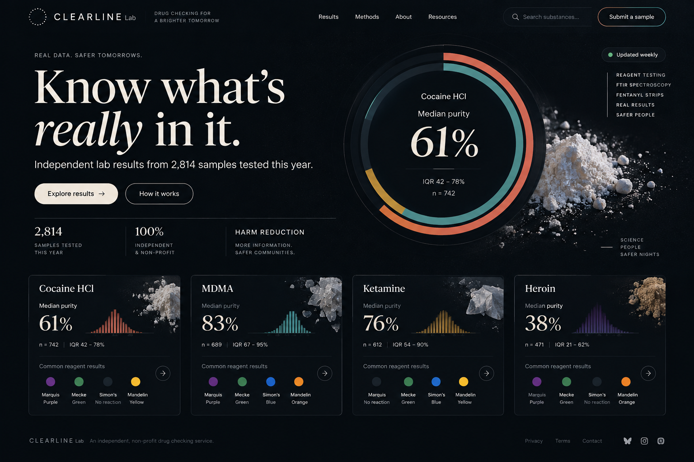

# Clearline

**Know what's really in it.** Clearline is an open-source website for a drug checking service. It publishes the
results of street drug samples tested with reagent kits, FTIR spectroscopy and fentanyl test strips: how pure each drug
is, what it's cut with, and when something dangerous shows up.

It is built for harm reduction. The site is calm, non-judgmental and plain-spoken, works well on cheap phones, and
treats the people who use it as adults making their own decisions.

> **The data in this repo is generated demo data.** Every number on the site comes from `data/samples.json`, which
> `bun run seed` fills with plausible but fake results. The site shows a "Demo data" banner on every page until that
> file is replaced with real lab results (see [docs/DATA.md](docs/DATA.md)).



## What's on the site

| Page | What it shows |
|------|---------------|
| `/` | The latest alert, median purity for every drug, a "sold as vs. actually found" chart and the newest samples |
| `/substances/[slug]` | One drug in depth: purity histogram, what else turned up, high-risk finds, month-by-month breakdown |
| `/check` → `/results/[id]` | A person enters the ID from their sample and sees their own result |
| `/alerts` | Every alert, newest first |
| `/alerts/[id]` | One alert, with a 1080x1920 story card (`/alerts/[id]/story.png`) for Instagram and TikTok |
| `/in/[area]`, `/in/[area]/substances[/slug]`, `/in/[area]/alerts` | The same pages filtered to one area. The header picker ("Use my location" or a searchable list) takes people there and remembers their choice on their device |
| `/methods` | What each test can and can't detect, and how people's privacy is protected |
| `/data` | The open dataset as JSON downloads (CC BY 4.0) |

## Running it

Needs [Bun](https://bun.sh) 1.4 or newer.

```bash
bun install
bun run dev        # http://localhost:3000
bun run seed       # regenerate the demo data in data/
bun run icons      # rebuild the favicons from src/lib/brand.ts (needs ImageMagick 7)
bun run lint
bun run build      # static build; every page, result, share image and story card is prerendered
```

Set `SITE_URL` (for example `https://clearline.example`) when the site has a domain. It's used for canonical URLs,
the sitemap, `robots.txt`, share images and the address on story cards. On Vercel the production URL is picked up
automatically.

There is no database and no server-side secrets. The whole site is generated at build time from the JSON files in
`data/`, so it can be hosted anywhere static files are served.

## How it's built

- **Next.js 16** (App Router, Cache Components) on **Bun**, with **Tailwind CSS 4** and TypeScript.
- **Dark mode only**, on purpose: one theme, no toggle. Colors live in `src/app/globals.css`.
- **Charts are hand-written SVG** in `src/components/charts.tsx`. No chart library, no client JavaScript, readable
  without scripts. Chart colors were checked for color-blind separation and contrast against the dark background.
- **Every number is computed** in `src/lib/data.ts` from the raw samples. Pages never hard-code a figure.

```
data/            the open dataset: samples, substances, reagents, alerts, areas
docs/            data dictionary, the original design mockups, and the brand (docs/brand/)
scripts/         the demo data generator, the icon builder and the Sunburst image generator
src/app/         pages, icons, share image, story cards, sitemap and the /data/*.json download routes
src/assets/      fonts and images used to draw the share image and story cards
src/views/      page bodies shared by the all-areas routes and their /in/[area] versions
src/components/  charts, substance and result cards, empty states, header, location picker and footer
src/lib/         types, data loading and aggregation, formatting, brand geometry, site metadata
```

## Privacy

Published results never include names, contact details, exact dates, venues or sellers. Each sample has a week and a
broad area, nothing finer. "Use my location" runs entirely in the browser: the position is matched to the nearest
area on the device and never sent anywhere; only the chosen area is remembered, in local storage. Sample IDs are the only link between a person and their result, and result pages are kept
out of search engines. See [docs/DATA.md](docs/DATA.md#privacy-rules) for the rules any real data must follow.

## Contributing

Issues and pull requests are welcome, especially from people who work in harm reduction or drug checking. See
[CONTRIBUTING.md](CONTRIBUTING.md).

## License

- **Code:** [MIT](LICENSE).
- **Data** (everything in `data/`): [CC BY 4.0](DATA-LICENSE.md). Reuse it freely, with credit to Clearline.

Nothing on this site is medical advice. Drug checking reduces risk; it can't remove it.
