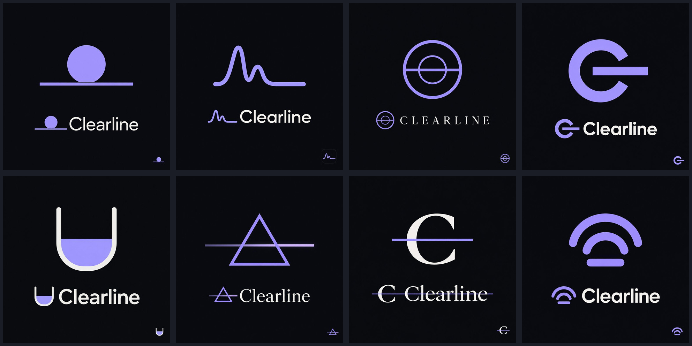

# Clearline brand

## The mark

A lab vessel with one level line across it: a level, honest reading. The liquid is lavender (`#a99dff`), the outline
is warm off-white (`#f0efec`), and it always sits on the dark page (`#0a0c11`) or panel (`#121620`).

The geometry lives in one place, `src/lib/brand.ts`, on a 32-unit grid. Everything else is drawn from it:

| Where | File | Made by |
|-------|------|---------|
| Header logo | `src/components/logo.tsx` | React SVG |
| Browser tab icon | `src/app/icon.svg`, `src/app/favicon.ico` (16, 32, 48 px) | `bun scripts/build-icons.ts` |
| Home screen icon | `src/app/apple-icon.png` (180 px) | `bun scripts/build-icons.ts` |
| Bare mark for others to use | `public/brand/mark.svg` | `bun scripts/build-icons.ts` |
| Social share image | `src/app/opengraph-image.tsx` (1200x630) | next/og at build time |
| Alert story cards | `src/app/alerts/[id]/story/route.tsx` (1080x1920) | next/og at build time |

If you change `src/lib/brand.ts`, run `bun scripts/build-icons.ts` (needs ImageMagick 7) so the static icons match.

The wordmark is "Clearline" in Geist Medium, sentence case. Headlines use Instrument Serif. Both are OFL fonts; the
copies the image renderer needs are in `src/assets/fonts/` with their licenses.

What the brand never shows: syringes, needles, pills, powder, smoke, skulls or anything that depicts or glamorizes
drug use.

## Where it came from (provenance)

The direction was picked from eight explorations made with **Sunburst**, OpenAI's `gpt-image-2.5-sunburst`, at
medium quality, 1024x1024, through `v1/images/generations`. Austin picked **meniscus** on 2026-10-24. The final mark
is redrawn by hand as vector geometry, not traced from the raster.

Top row: horizon, spectrum, lens, C-line. Bottom row: meniscus (chosen), prism, wordmark, beacon.

The site art came from the same model, at medium quality:

| Image | Used for | Prompt |
|-------|----------|--------|
| `hero-spectrum-v1` (1536x1024) | Home hero texture (`public/images/hero-spectrum.webp`) and the share image background (`src/assets/images/og-spectrum.jpg`) | `scripts/sunburst/hero-spectrum.txt` |
| `hero-meniscus-v1` (1536x1024) | "How we test" header (`public/images/methods-meniscus.webp`) | `scripts/sunburst/hero-meniscus.txt` |
| `story-calm-v1` (1024x1536) | Alert story card background (`src/assets/images/story-horizon.jpg`) | `scripts/sunburst/story-calm.txt` |

Every prompt is in `scripts/sunburst/` and was sent exactly as written by `bun scripts/sunburst.ts <name>`. Each call
is logged in [`sunburst-calls.jsonl`](sunburst-calls.jsonl): endpoint, model, size, quality, token usage, cost and the
SHA-256 of the image that came back. The untouched outputs stay in the git-ignored `.sunburst/` folder; only the
images we use are committed, resized and compressed.
